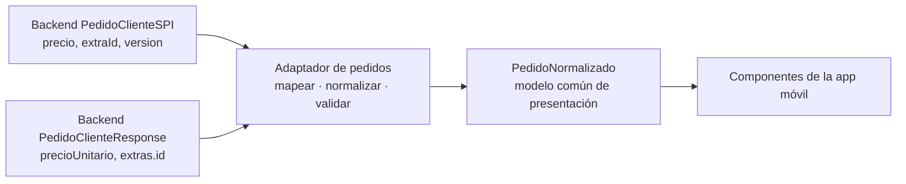

# Traducción y normalización de pedidos

La app consume dos representaciones JSON de un pedido que conviven en el backend: el SPI empleado por el canal móvil y la respuesta REST utilizada por el canal web. El adaptador móvil los traduce a `PedidoNormalizado`, un modelo de presentación común, sin cambiar los contratos de origen.

## Estructuras de origen

| Significado | SPI móvil | DTO REST web | Modelo común |
|---|---|---|---|
| Pago y entrega | `metodoPago`, `metodoEntrega` | mismos campos | `pago`, `entrega` en mayúscula |
| Precio unitario | `lineas[].precio` | `lineas[].precioUnitario` | `lineas[].precioUnitario` numérico |
| Identificador de extra | `extras[].extraId` | `extras[].id` | `extras[].id` entero |
| Subtotal del pedido | `subtotal` explícito | se calcula desde subtotales de línea | `subtotal` numérico a 2 decimales |
| Total | `total` explícito | `total` puede llegar como texto decimal | número con dos decimales |
| Fecha de creación | `creadoAt` ISO con zona | `creadoAt` ISO con zona | `creadoEn` ISO UTC |
| Versión interna | `version` | ausente | se excluye del modelo común de presentación |

## Reglas de traducción

`desdeSpi` y `desdeRespuestaWeb` son funciones puras del módulo móvil `features/pedidos/normalizarPedido.ts`. Ambas delegan en un conversor común y preservan los objetos de origen. Los campos descriptivos se recortan; pago y entrega se recortan y convierten a mayúsculas; montos aceptan números o texto decimal sin separadores ambiguos, se redondean a centavos y deben ser finitos y no negativos. Las fechas deben incluir zona horaria y se convierten a UTC. Se rechazan campos obligatorios vacíos, tipos incorrectos, cantidades no enteras/positivas, extras mal formados y totales que no equivalen al subtotal más el costo de entrega (tolerancia de un centavo).

## Pruebas

Las pruebas reproducibles están en `mobile/tests/normalizarPedido.test.mjs` y se ejecutan con Node compatible:

```powershell
cd mobile
node --experimental-strip-types --test tests/normalizarPedido.test.mjs
```

| Prueba | Entrada | Resultado comprobado |
|---|---|---|
| P1 | SPI con precio, extraId, espacios y fecha -05:00 | campos normalizados, precio numérico y fecha UTC |
| P2 | DTO web equivalente, precioUnitario y extras.id en texto decimal | salida profunda idéntica a P1 |
| P3 | total inconsistente y fecha sin zona | ambos se rechazan con error explícito |

## Diagrama



El patrón se ubica en el límite de la feature de pedidos para evitar que los componentes de interfaz dependan de nombres y formatos propios de cada respuesta. La validación permite detectar errores de integración en cuanto entra el dato. El backend mantiene sus contratos actuales. La prueba cubre transformación unitaria con datos ficticios; no sustituye una llamada a un backend desplegado.

## Reflexión

Resolví la diferencia entre los SPI de pedidos del canal móvil y el DTO REST que usa el canal web: difieren en los nombres de precio y del identificador de extra, y el segundo no aporta todos los campos del primero. Decidí concentrar el mapeo, la normalización y la validación en un adaptador puro y reutilizable dentro de la feature móvil. Comprobé que dos entradas equivalentes generan el mismo modelo y que importes incoherentes o fechas ambiguas producen errores controlados.

## Evidencia individual

La guía de la actividad solicita que el estudiante trabaje en una rama o módulo propio identificado con su nombre o código. El adaptador y las pruebas quedan preparados en el repositorio para revisión y personalización. Completa tu nombre, paralelo y código, y registra tu propia ejecución antes de entregar; esos datos personales y esa ejecución no se inventan en este documento.
