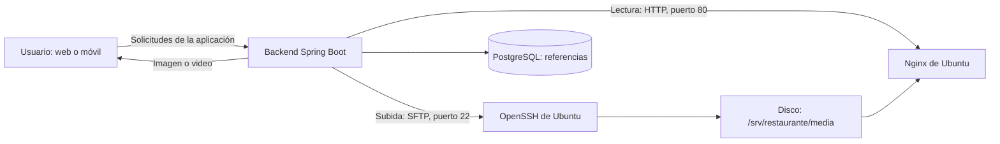

# Servidor local de imágenes y videos en Ubuntu

Esta guía explica cómo preparar una máquina virtual de Ubuntu Server, conectarla
al backend y utilizar la subida de archivos desde el catálogo. Los archivos
permanecen en el disco de Ubuntu; sus referencias se guardan en PostgreSQL.

Está organizada para Windows con PowerShell, VirtualBox y Ubuntu Server con
Netplan. La instalación del proyecto utiliza Ubuntu Server 26.04 LTS. Los nombres
de interfaz y archivo de red pueden variar en otra instalación.

## 1. Qué hace cada componente

| Componente | Responsabilidad |
| --- | --- |
| Web del restaurante | Permite seleccionar el archivo, mostrar una vista previa y guardar el producto. |
| Backend Spring Boot | Comprueba permisos y contenido, transfiere archivos y mantiene las referencias. |
| OpenSSH/SFTP de Ubuntu | Recibe las transferencias del backend por el puerto 22. |
| Disco de Ubuntu | Conserva las imágenes y los videos en `/srv/restaurante/media/`. |
| Nginx de Ubuntu | Entrega los archivos al backend mediante HTTP por el puerto 80. |
| PostgreSQL | Guarda metadatos y asociaciones con productos; no guarda el contenido binario. |
| Aplicación móvil | Consulta el backend para mostrar imágenes y abrir los videos del catálogo. |

El backend tiene **dos conexiones diferentes** con Ubuntu:



SFTP se utiliza para escribir o eliminar archivos. HTTP se utiliza para leerlos.
Nginx no recibe la subida del formulario: la recibe el backend y la transfiere
por SFTP. La contraseña de un usuario administrador de la aplicación tampoco
es una credencial de Ubuntu.

## 2. Valores que debes identificar antes de empezar

Los ejemplos siguientes usan los valores de la instalación local. Adáptalos si
tu red o tus usuarios son diferentes.

| Dato | Ejemplo de esta guía |
| --- | --- |
| IP de Ubuntu, servidor de archivos | `192.168.100.77` |
| Red local y prefijo | `192.168.100.0/24` |
| Puerta de enlace | `192.168.100.1` |
| DNS de la red | `192.168.100.1` |
| Interfaz de red de Ubuntu | `enp0s3` |
| Usuario administrador de Ubuntu | `oscar` |
| Usuario de transferencia del backend | `archivosapp`, creado por el script |
| Puerto del backend en Windows | `8080` |
| Puerto de la interfaz web | `3000` |
| Base de desarrollo usada en esta guía | `restaurante_archivos` |

La IP del backend puede ser distinta de la IP de Ubuntu. En esta configuración,
el backend corre en Windows/Docker y Ubuntu almacena los archivos. Un teléfono
debe comunicarse con la IP del **equipo del backend**, no con la IP de Nginx.

Antes de comenzar necesitas VirtualBox, Ubuntu Server instalado, Docker Desktop
para el backend y PostgreSQL, Node.js para la web y un cliente OpenSSH en Windows.
Puedes comprobar el último requisito en PowerShell con `ssh -V`.

Para una VM de pruebas, 2 CPU, 2 GB de RAM y un disco de 40 GB son un punto de
partida. Dimensiona el disco según los archivos que guardarás; un video puede
ocupar hasta 100 MiB. Consulta el espacio real dentro de Ubuntu con `df -h`.

## 3. Conectar la VM a la red local

**En Windows, dentro de VirtualBox:**

1. Apaga Ubuntu con `sudo poweroff` desde su consola.
2. Selecciona la VM y abre **Configuración → Red → Adaptador 1**.
3. Activa el adaptador y selecciona **Adaptador puente**.
4. En **Nombre**, elige la tarjeta Ethernet o Wi-Fi que realmente usa Windows.
5. Mantén activada la opción **Cable conectado**.
6. Guarda e inicia Ubuntu.

El modo puente permite que la VM tenga su propia dirección en la misma red
local. La red debe permitir comunicación entre los equipos conectados.

**En Ubuntu**, inicia sesión y ejecuta uno por uno:

```bash
ip -br address
ip route
```

Identifica la interfaz que tiene una dirección de la red local y la ruta que
empieza por `default via`. La interfaz `lo`, con `127.0.0.1`, es interna del
propio sistema y no es la dirección que utilizará Windows.

**En PowerShell de Windows**, comprueba la IP obtenida por Ubuntu:

```powershell
ping 192.168.100.77
```

Continúa cuando Windows pueda comunicarse con Ubuntu. Estos ejemplos configuran
la IP directamente en Ubuntu y no requieren entrar al router.

## 4. Configurar una IP estática con Netplan

Usa una dirección disponible y apropiada para tu red. Fijarla en Ubuntu no la
reserva en el servidor DHCP de la red: debes evitar que otro equipo utilice esa
misma dirección.

Haz esta configuración desde la **consola de VirtualBox** para conservar acceso
aunque estés cambiando la red de Ubuntu.

### 4.1. Identificar y respaldar el archivo

**En Ubuntu:**

```bash
ls -l /etc/netplan/
sudo netplan get
sudo cp -a /etc/netplan /root/netplan-respaldo-$(date +%Y%m%d-%H%M%S)
```

En esta instalación el archivo es `00-installer-config.yaml`. Si el tuyo tiene
otro nombre, usa ese nombre en los comandos siguientes. Conserva cualquier
configuración necesaria de otras interfaces; no crees archivos que configuren
la misma interfaz de formas contradictorias.

```bash
sudo nano /etc/netplan/00-installer-config.yaml
```

### 4.2. Escribir la configuración

Para la interfaz y red del ejemplo:

```yaml
network:
  version: 2
  ethernets:
    enp0s3:
      dhcp4: false
      dhcp6: true
      addresses:
        - 192.168.100.77/24
      routes:
        - to: default
          via: 192.168.100.1
      nameservers:
        addresses:
          - 192.168.100.1
```

Usa espacios para la sangría. `dhcp4: false` desactiva la asignación automática
de IPv4; `addresses` establece la dirección fija; `routes` indica la salida de
la red y `nameservers` configura la resolución de nombres. Si el archivo ya usa
`match` y `set-name` para identificar la tarjeta, conserva sus valores correctos.

En Nano, guarda con **Ctrl + O**, confirma con **Enter** y sal con **Ctrl + X**.

### 4.3. Validar y conservar el cambio

```bash
sudo chmod 600 /etc/netplan/00-installer-config.yaml
sudo netplan generate
sudo netplan try --timeout 120
```

Si la prueba es correcta, confirma con **Enter** antes de que termine el contador.
Después verifica:

```bash
ip -br address
ip route
ping -c 4 192.168.100.1
getent hosts ubuntu.com
```

Repite el ping desde Windows, reinicia Ubuntu con `sudo reboot` y comprueba que
conserva la IP al volver a iniciar sesión.

## 5. Preparar Ubuntu y las carpetas

**En Ubuntu:**

```bash
sudo apt update
sudo apt install -y nginx openssh-server acl curl
sudo systemctl enable --now nginx
sudo systemctl enable --now ssh
```

Comprueba los servicios:

```bash
systemctl is-active nginx
systemctl is-active ssh
```

Ambos deben mostrar `active`. Prepara las carpetas:

```bash
sudo mkdir -p /srv/restaurante/media/imagenes
sudo mkdir -p /srv/restaurante/media/videos
sudo chown oscar:www-data /srv/restaurante/media /srv/restaurante/media/imagenes /srv/restaurante/media/videos
sudo chmod 755 /srv/restaurante
sudo chmod 2750 /srv/restaurante/media /srv/restaurante/media/imagenes /srv/restaurante/media/videos
```

Sustituye `oscar` si usas otro usuario administrador. El propietario puede
escribir, el grupo `www-data` de Nginx puede leer y recorrer las carpetas, y el
bit `2` hace que los nuevos archivos hereden el grupo del directorio. El script
de la sección 7 añadirá permisos específicos para `archivosapp` mediante ACL.

```text
/srv/restaurante/media/
├── imagenes/
└── videos/
```

## 6. Configurar Nginx para entregar los archivos

### 6.1. Crear el sitio

**En Ubuntu:**

```bash
sudo nano /etc/nginx/sites-available/restaurante-media
```

Contenido para la IP del ejemplo:

```nginx
server {
    listen 80;
    server_name 192.168.100.77;

    add_header X-Content-Type-Options nosniff always;

    location /media/ {
        alias /srv/restaurante/media/;
        autoindex off;
        disable_symlinks on;

        limit_except GET {
            deny all;
        }
    }

    location / {
        return 404;
    }
}
```

El `alias` conecta la ruta web `/media/` con la carpeta física. Ambas terminan
con `/`. La carpeta no muestra listados; se permite consultar archivos mediante
GET y HEAD, pero no subirlos por HTTP. Este sitio solo publica rutas bajo `/media/`.

Guarda y sal de Nano. Activa el sitio una sola vez:

```bash
sudo ln -s /etc/nginx/sites-available/restaurante-media /etc/nginx/sites-enabled/restaurante-media
sudo nginx -t
sudo systemctl reload nginx
```

Si el enlace ya existe, conserva el enlace y ejecuta la comprobación y la recarga.
La salida de `nginx -t` debe indicar que la sintaxis y la comprobación son correctas.

### 6.2. Verificar una lectura

```bash
printf 'Servidor de archivos del restaurante listo.\n' > /srv/restaurante/media/prueba.txt
chmod 640 /srv/restaurante/media/prueba.txt
cat /srv/restaurante/media/prueba.txt
```

El símbolo `>` guarda el texto en el archivo. **Desde el navegador de Windows**,
abre `http://192.168.100.77/media/prueba.txt`. Debes ver el mismo texto.
No necesitas recargar Nginx cada vez que agregas un archivo a estas carpetas.

### 6.3. Acceso de red

El backend debe poder llegar a Ubuntu por TCP 22 y TCP 80. Si habilitas UFW en
una VM nueva para la red del ejemplo, permite ambos accesos antes de activarlo:

```bash
sudo ufw allow from 192.168.100.0/24 to any port 22 proto tcp
sudo ufw allow from 192.168.100.0/24 to any port 80 proto tcp
sudo ufw enable
sudo ufw status
```

Si ya administras otras reglas, integra estos permisos en esa configuración.
Nginx publica estos archivos a los equipos que puedan alcanzarlo: este directorio
es para material del catálogo, no para documentos privados.

## 7. Autorizar al backend mediante una clave SSH

Esta preparación se realiza una vez por clave y servidor. Hay tres usuarios
distintos: `oscar` administra Ubuntu, `archivosapp` transfiere archivos y el
usuario de la aplicación administra los productos.

### 7.1. Generar los archivos de acceso

**En PowerShell, desde la raíz del repositorio:**

```powershell
New-Item -ItemType Directory -Force backend/.local/ssh
ssh-keygen -t ed25519 -f backend/.local/ssh/archivos_backend -C restaurante-archivos
```

Cuando solicite una frase de paso, pulsa **Enter** y vuelve a pulsar **Enter**
para confirmarla vacía. La conexión automática implementada carga la clave
directamente, sin solicitar una frase interactiva. Si la clave ya existe, no
la sobrescribas: continúa con la clave autorizada que ya utiliza el backend.

Se crean dos archivos:

| Archivo | Dónde se conserva |
| --- | --- |
| `archivos_backend` | Clave privada: solo en el equipo del backend. |
| `archivos_backend.pub` | Clave pública: se copia a Ubuntu para autorizar el acceso. |

La carpeta `.local` está excluida de Git y del contexto de construcción Docker.
Protege el acceso a la clave privada en el equipo que la almacena.

### 7.2. Verificar la identidad de Ubuntu

**Desde la consola de Ubuntu:**

```bash
sudo ssh-keygen -lf /etc/ssh/ssh_host_ed25519_key.pub
```

Anota la huella que empieza por `SHA256:`. **En PowerShell**, realiza la primera
conexión con el usuario administrador:

```powershell
ssh oscar@192.168.100.77 "exit"
```

Si pregunta si confías en el servidor, compara la huella ED25519 con la de la
consola. Acepta con `yes` únicamente si coincide e introduce la contraseña de
`oscar` cuando se solicite. La conexión queda registrada en `known_hosts`.

Prepara la copia que leerá el backend:

```powershell
ssh-keygen -F 192.168.100.77 -f "$env:USERPROFILE\.ssh\known_hosts" | Set-Content -Encoding ascii backend/.local/ssh/known_hosts
ssh-keygen -lf backend/.local/ssh/known_hosts
```

`known_hosts` identifica al servidor; la clave privada identifica al backend.
La implementación verifica esa identidad antes de autenticarse. Si utilizas un
puerto diferente de 22, usa el puerto correspondiente en SSH/SFTP y la entrada
`[IP]:PUERTO` al buscar en `known_hosts`.

### 7.3. Copiar y ejecutar el script de preparación

**En PowerShell, desde la raíz del repositorio:**

```powershell
scp .\scripts\preparar-archivos-ubuntu.sh .\backend\.local\ssh\archivos_backend.pub oscar@192.168.100.77:/home/oscar/
```

Solo se copian el script y la clave **pública**. **En Ubuntu:**

```bash
sudo bash /home/oscar/preparar-archivos-ubuntu.sh /home/oscar/archivos_backend.pub
```

El script realiza estas operaciones:

1. Respalda Nginx y media en `/root/antes-archivos-<fecha>.tar.gz`.
2. Comprueba la instalación de ACL y OpenSSH.
3. Crea `archivosapp`, si aún no existe, con shell de inicio de sesión deshabilitada.
4. Añade la clave pública a su archivo `authorized_keys`, con restricciones para
   usar SFTP y sin terminal ni reenvíos de puertos.
5. Otorga acceso de escritura a las tres carpetas mediante ACL, conservando a `oscar`.
6. Habilita el servicio SSH.

El resultado final debe indicar que el acceso SFTP está preparado. El script
puede ejecutarse de nuevo con la misma clave. Sus rutas están definidas para
`/srv/restaurante/media/`; si eliges otra estructura, adapta también el script.

### 7.4. Comprobar la conexión automática

**En PowerShell, desde la raíz del repositorio:**

```powershell
'ls /srv/restaurante/media/imagenes' | sftp -b - -i backend/.local/ssh/archivos_backend -o BatchMode=yes -o StrictHostKeyChecking=yes -o UserKnownHostsFile=backend/.local/ssh/known_hosts archivosapp@192.168.100.77
```

Debe listar la carpeta y finalizar sin solicitar contraseña. Esta prueba utiliza
la misma clave y verificación de identidad que necesitará la aplicación. Se usa
SFTP porque la clave de `archivosapp` no autoriza una consola de administración.

## 8. Configurar los archivos de entorno

Las plantillas y sus responsabilidades son diferentes:

| Plantilla | Archivo local | Uso |
| --- | --- | --- |
| `.env.example` de la raíz | `.env` de la raíz | Variables de Docker Compose: base de datos, puertos y conexión al almacenamiento. |
| `backend/.env.example` | `backend/.env` | Secreto JWT, contraseña inicial y configuración del proceso Java. |
| `frontend/.env.example` | `frontend/.env.local` | Dirección del backend usada por Next.js. |

En una instalación nueva puedes crear solo los archivos que aún no existen:

```powershell
if (-not (Test-Path .env)) { Copy-Item .env.example .env }
if (-not (Test-Path backend/.env)) { Copy-Item backend/.env.example backend/.env }
if (-not (Test-Path frontend/.env.local)) { Copy-Item frontend/.env.example frontend/.env.local }
```

Si ya tienes `.env`, compara las plantillas e incorpora únicamente las variables
necesarias. Conserva contraseñas, secretos y nombres de bases existentes. El detalle
de cada variable y su precedencia está en [variables-entorno.md](variables-entorno.md).

### 8.1. Backend en Docker: opción habitual

En el `.env` de la **raíz**, configura los valores de tu instalación. Por ejemplo:

```dotenv
DB_NAME=restaurante_archivos
DB_USER=restaurante
DB_PASSWORD=una-contrasena-propia
ARCHIVOS_HABILITADO=true
ARCHIVOS_HOST=192.168.100.77
ARCHIVOS_PUERTO=22
ARCHIVOS_USUARIO=archivosapp
ARCHIVOS_DIRECTORIO=/srv/restaurante/media
ARCHIVOS_LECTURA_URL=http://192.168.100.77/media/
ARCHIVOS_TIMEOUT=15s
```

En `backend/.env`, configura `JWT_SECRET` y `ADMIN_INITIAL_PASSWORD` con valores
propios. Para generar un secreto aleatorio puedes ejecutar en PowerShell:

```powershell
node -e "console.log(require('node:crypto').randomBytes(64).toString('hex'))"
```

Copia el resultado en `JWT_SECRET`. La contraseña inicial crea al usuario `admin`
cuando aún no existe; cambiar esa variable no cambia la contraseña de un usuario
ya creado.

El compose realiza este montaje de **solo lectura**:

```text
Windows: backend/.local/ssh/       Contenedor Java: /run/archivos/
         archivos_backend          → archivos_backend
         known_hosts               → known_hosts
```

Por eso fija las rutas internas `/run/archivos/archivos_backend` y
`/run/archivos/known_hosts`. No coloques una ruta `C:/...` como ruta de clave de
un contenedor Linux. La clave se monta al arrancar y no se incorpora a la imagen.

### 8.2. Backend ejecutado directamente con Java

Configura `backend/.env` con las mismas variables `ARCHIVOS_*`, más las rutas
absolutas de los archivos en el equipo donde se ejecuta Java:

```dotenv
ARCHIVOS_CLAVE_PRIVADA=C:/ruta/al/proyecto/backend/.local/ssh/archivos_backend
ARCHIVOS_KNOWN_HOSTS=C:/ruta/al/proyecto/backend/.local/ssh/known_hosts
```

Utiliza barras `/` en las rutas de Windows. Configura también la conexión real
a PostgreSQL en ese archivo. Si PostgreSQL está en el compose y Java está en
Windows, `DB_HOST=localhost` y `DB_PORT` debe ser el puerto publicado del host.

### 8.3. Interfaz web y móvil

En `frontend/.env.local`:

```dotenv
BACKEND_URL=http://localhost:8080
```

Es la dirección del **backend**, sin `/api/v1`. Next.js reenvía las peticiones
`/api/*` al backend. El frontend no necesita la contraseña de Ubuntu ni claves SSH.

En desarrollo, el móvil deriva la IP del backend a partir del servidor de Expo.
Los archivos del menú se consultan a través de ese backend. En un teléfono físico,
`localhost` representa al teléfono; usa una dirección del backend alcanzable desde
su red. Consulta [la guía móvil](../mobile/README.md) para la configuración de su API.

## 9. Preparar PostgreSQL y arrancar

**En PowerShell, desde la raíz del repositorio:**

```powershell
docker compose up -d postgres
```

En un volumen nuevo, PostgreSQL crea la base indicada por `DB_NAME`. Si el volumen
ya existía, cambiar `DB_NAME` no crea automáticamente otra base. Para crear
`restaurante_archivos` con el usuario del ejemplo:

```powershell
docker exec restaurante-postgres createdb -U restaurante -O restaurante restaurante_archivos
```

Ejecuta esa creación solo si la base aún no existe y sustituye usuario/nombre si
los cambiaste. Puedes listar las bases con:

```powershell
docker exec restaurante-postgres psql -U restaurante -d postgres -c '\l'
```

### 9.1. Iniciar el backend en Docker

```powershell
docker compose config --quiet
docker compose up -d --build backend
docker compose ps
```

Flyway aplica las migraciones al arrancar. V12 crea el esquema `archivos`, añade
las referencias opcionales `imagen_archivo_id` y `video_archivo_id` al producto,
y añade su campo de versión. Los archivos físicos permanecen en Ubuntu.

El complemento `docker-compose.archivos.yml` permite activar este modo de forma
explícita. Si lo utilizas, su `ARCHIVOS_DB_NAME` selecciona la base del backend:

```powershell
docker compose -f docker-compose.yml -f docker-compose.archivos.yml up -d --build backend
```

Mantén `ARCHIVOS_DB_NAME` y `DB_NAME` coherentes cuando ambos servicios utilicen
la misma base. Para la configuración habitual de esta guía basta el compose base.

### 9.2. Iniciar el backend nativo, como alternativa

Necesitas JDK 25 y PostgreSQL disponible. No ejecutes simultáneamente el backend
de Docker y el nativo en el mismo puerto.

```powershell
Set-Location backend
$env:SPRING_PROFILES_ACTIVE = 'dev'
.\mvnw.cmd spring-boot:run
```

### 9.3. Iniciar la web

**En otra terminal, desde la raíz del repositorio:**

```powershell
Set-Location frontend
npm.cmd ci
npm.cmd run dev
```

Abre `http://localhost:3000` e inicia sesión. La salud del backend puede consultarse
en `http://localhost:8080/actuator/health`.

### 9.4. Copiar un catálogo anterior, si lo necesitas

Esta operación es opcional y corresponde a la preparación de datos, no al
funcionamiento diario del servidor. El origen del ejemplo es `restaurante` y el
destino es `restaurante_archivos`. La base de origen se conserva.

Usa este procedimiento únicamente con un catálogo de estructura compatible,
sin referencias multimedia gestionadas, y con las tablas de catálogo vacías en
el destino. La base de destino debe haber recibido antes sus migraciones. Si el
origen ya utiliza `imagen_archivo_id` o `video_archivo_id`, respalda y migra
también sus metadatos de archivos y sus medios; copiar solo productos no basta.

**En PowerShell**, confirma primero el contenido del destino:

```powershell
docker exec restaurante-postgres psql -U restaurante -d restaurante_archivos -c "SELECT count(*) AS productos FROM catalogo.productos; SELECT count(*) AS categorias FROM catalogo.categorias; SELECT count(*) AS areas FROM catalogo.areas; SELECT count(*) AS extras FROM catalogo.extras;"
```

Los cuatro resultados deben ser cero para esta copia inicial. Detén el backend
durante la operación y copia las tablas del catálogo:

```powershell
docker compose stop backend
docker exec restaurante-postgres pg_dump -U restaurante -d restaurante --data-only --column-inserts -t catalogo.categorias -t catalogo.areas -t catalogo.extras -t catalogo.productos -t catalogo.producto_extras -t catalogo.producto_ingredientes -f /tmp/catalogo_inicial.sql
docker exec restaurante-postgres psql -v ON_ERROR_STOP=1 --single-transaction -U restaurante -d restaurante_archivos -f /tmp/catalogo_inicial.sql
docker compose up -d backend
```

Comprueba que la copia termine correctamente antes de arrancar el backend. El
volcado utiliza nombres de columnas y conserva los identificadores; las nuevas
columnas opcionales del destino toman sus valores por defecto. No se copian
usuarios, sesiones, pedidos ni archivos físicos mediante estos comandos.

## 10. Utilizar la subida desde la aplicación

1. Entra a **Productos** con un usuario que tenga `catalogo:gestionar`.
2. Crea un producto o abre uno existente con **Editar**.
3. Pulsa **Seleccionar imagen** o **Cambiar imagen** y elige un archivo del equipo.
4. Si lo necesitas, selecciona también un video.
5. Revisa la vista previa y pulsa **Guardar producto**.
6. Espera a que termine la subida y el guardado. Después recarga el catálogo.

La vista previa utiliza un recurso local del navegador; seleccionar un archivo
todavía no lo publica en Ubuntu. La transferencia comienza al guardar. El usuario
puede quitar o cambiar la selección antes de guardar, sin utilizar enlaces.

| Campo | Formatos | Límite |
| --- | --- | --- |
| Imagen principal | JPG, PNG, WebP | 10 MiB; para JPG/PNG se limita además a 25 megapíxeles. |
| Video opcional | MP4, WebM | 100 MiB. |

La interfaz expresa estos tamaños como MB. El backend comprueba el contenido,
no solo la extensión. No se realiza conversión automática de video: utiliza
MP4 con H.264/AAC o WebM reproducible por el dispositivo. En la web hay controles
de reproducción; en móvil, **Ver video del producto** abre el visor del dispositivo.

## 11. Cómo se guarda y recupera un archivo

### Subida y asociación

1. La web envía un formulario `multipart/form-data` con el campo `archivo` al backend.
2. El backend comprueba el permiso del usuario, tamaño y tipo del contenido.
3. Genera un UUID para el nombre remoto y elige `imagenes/` o `videos/`.
4. Se conecta a `ARCHIVOS_HOST:ARCHIVOS_PUERTO`, verifica `known_hosts` y se
   autentica con `ARCHIVOS_USUARIO` y la clave privada.
5. Transfiere a un nombre terminado en `.part`, asigna modo `640` y renombra al
   nombre definitivo al completar la transferencia.
6. Registra el archivo como `PENDIENTE` en PostgreSQL y devuelve su identificador.
7. La web guarda el producto con `imagenArchivoId` o `videoArchivoId`. El archivo
   pasa a `VINCULADO` dentro de la misma transacción de la asociación del producto.

### Lectura

Para una imagen identificada por un UUID, las tres ubicaciones son diferentes:

```text
Disco de Ubuntu:
  /srv/restaurante/media/imagenes/UUID.png

URL de Nginx que consulta el backend:
  http://192.168.100.77/media/imagenes/UUID.png

URL estable que utiliza la aplicación:
  /api/v1/archivos/UUID/contenido
```

El backend busca los metadatos por UUID, construye la URL de Nginx a partir de
`ARCHIVOS_LECTURA_URL` y transmite el contenido al cliente. Conserva el tipo MIME
y las cabeceras necesarias para las lecturas parciales de video. No devuelve
la clave SSH ni una ruta de Windows al navegador.

| Endpoint | Función | Acceso |
| --- | --- | --- |
| `POST /api/v1/archivos` | Subir un archivo; devuelve `201` con ID y URL. | Permiso `catalogo:gestionar`. |
| `GET /api/v1/archivos/{id}/contenido` | Leer contenido; admite un rango simple `Range`. | Público si está vinculado; temporal solo para su propietario autenticado. |
| `HEAD /api/v1/archivos/{id}/contenido` | Consultar cabeceras sin descargar el cuerpo. | Igual que GET. |
| `DELETE /api/v1/archivos/{id}` | Descartar una subida temporal propia. | Permiso `catalogo:gestionar`; no elimina un archivo vinculado. |

Ejemplo de respuesta de subida; los valores son ilustrativos:

```json
{
  "id": "a77b65e7-9724-4679-8a13-3c722d618d5f",
  "nombre": "hamburguesa.png",
  "tipo": "IMAGEN",
  "contenidoTipo": "image/png",
  "tamano": 134000,
  "url": "/api/v1/archivos/a77b65e7-9724-4679-8a13-3c722d618d5f/contenido"
}
```

El registro conserva nombre original, clave remota, tamaño, tipo, propietario,
producto, fechas y estado. Los productos anteriores que tienen `imagenUrl`
continúan siendo compatibles. Para quitar un video mediante la API se envía
`quitarVideo: true`; omitir ese campo conserva el video existente.

## 12. Persistencia, limpieza y respaldo

Los medios permanecen en Ubuntu al cerrar el navegador o reiniciar el backend.
PostgreSQL debe conservar su volumen y Ubuntu debe conservar su disco virtual.

Al reemplazar un archivo, el anterior pasa a `RETIRADO` después de guardar la
asociación. Cada 10 minutos se procesan hasta 50 temporales o retirados de más
de 24 horas. Los archivos `VINCULADO` no se incluyen en esa limpieza. La limpieza
no recorre ni elimina los archivos manuales ajenos a los registros del módulo.

La asociación del producto participa en una transacción de PostgreSQL; una
transferencia SFTP es una operación externa. El sistema intenta compensar una
subida revertida y conserva el medio anterior si no se confirma el reemplazo.
La administración debe contemplar conciliación de temporales tras interrupciones
abruptas. Una URL directa de Nginx puede seguir entregando un medio retirado hasta
que se elimine físicamente: no es un sistema de documentos privados.

Respalda **la base y la carpeta de medios** de forma coordinada. Para una copia
de mantenimiento, evita subidas/cambios mientras tomas ambos respaldos.

**En PowerShell**, para el PostgreSQL y nombres del ejemplo:

```powershell
New-Item -ItemType Directory -Force database/backups
$respaldo = "restaurante_archivos_$(Get-Date -Format yyyyMMdd_HHmmss).dump"
docker exec restaurante-postgres pg_dump -U restaurante -d restaurante_archivos -Fc -f /tmp/restaurante_archivos.dump
docker exec restaurante-postgres pg_restore --list /tmp/restaurante_archivos.dump
docker cp restaurante-postgres:/tmp/restaurante_archivos.dump "database/backups/$respaldo"
```

**En Ubuntu**, para Nginx y los medios:

```bash
sudo tar --acls -czpf /root/restaurante-media-$(date +%Y%m%d-%H%M%S).tar.gz /srv/restaurante/media /etc/nginx/sites-available/restaurante-media
```

Copia los respaldos a otro disco o equipo local. Conserva por separado las claves
del backend y su configuración. Los `.env`, claves y respaldos están excluidos
del repositorio. Los scripts generales de base están descritos en
[database/README.md](../database/README.md).

## 13. Comprobación final

Antes de utilizar la instalación, verifica lo siguiente:

- Windows alcanza la IP estática de Ubuntu, también después de reiniciarlo.
- Nginx entrega `prueba.txt` y la prueba SFTP termina sin contraseña.
- El backend está sano y el frontend abre el catálogo.
- Una imagen seleccionada se guarda y permanece al recargar.
- Un video seleccionado se reproduce y permite avanzar en el navegador.
- Tras reiniciar el backend, ambos siguen disponibles.
- El menú móvil consulta los archivos a través del backend.

Para comprobaciones automatizadas del código:

```powershell
# Dentro de backend/, con Docker disponible para Testcontainers:
.\mvnw.cmd test '-Dtest=ArchivosIntegrationTest,ValidadorArchivoTest,ProductoRequestCompatibilidadTest'
```

```powershell
# Dentro de frontend/:
npm.cmd run lint
npm.cmd run build
```

## Referencias técnicas

- [Configuración de red de Ubuntu](https://ubuntu.com/server/docs/explanation/networking/configuring-networks/).
- [Prueba de configuración con Netplan](https://netplan.readthedocs.io/en/stable/netplan-try/).
- [Directivas de Nginx](https://nginx.org/en/docs/http/ngx_http_core_module.html).
- [Variables e interpolación de Docker Compose](https://docs.docker.com/compose/how-tos/environment-variables/variable-interpolation/).
