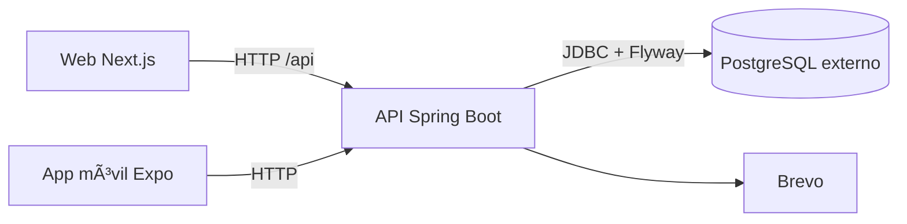

# Arquitectura del sistema

## Vista general

Monorepo con tres clientes/componentes principales: API Spring Boot modular, aplicación web Next.js y aplicación móvil Expo. La API persiste en PostgreSQL externo. La web enruta `/api/*` al backend; la app móvil usa la URL de API configurada para su entorno.

## Backend

El backend implementa un monolito modular con Spring Modulith. Los módulos de dominio encapsulan web, aplicación, dominio e infraestructura cuando corresponde. Los contratos HTTP se exponen mediante controladores y DTO; repositorios JPA conectan dominio/aplicación con PostgreSQL. Flyway versiona el esquema. Seguridad basada en Spring Security y JWT reside principalmente en usuarios.

## Clientes

La web utiliza Next.js App Router, módulos por feature y un cliente HTTP común; el rewrite de Next evita que el navegador necesite conocer el host interno del backend. La app móvil organiza rutas Expo y módulos compartidos/funcionales; su dirección API se resuelve según la configuración del cliente.

## Despliegue

Docker Compose ejecuta backend y web. PostgreSQL es un servicio externo y debe estar disponible antes de que arranque la API. La API aplica migraciones al inicio. Producción y variables sensibles se configuran según [produccion.md](../operacion/despliegue.md).

## Límites conocidos

La topología real de producción, proveedor cloud, terminación TLS, dominios, escalado horizontal y alta disponibilidad dependen del entorno y deben confirmarse con su operador.

